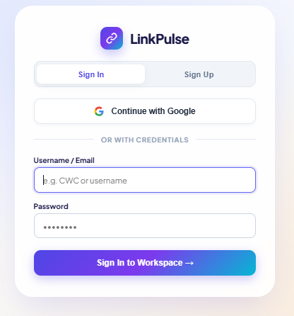
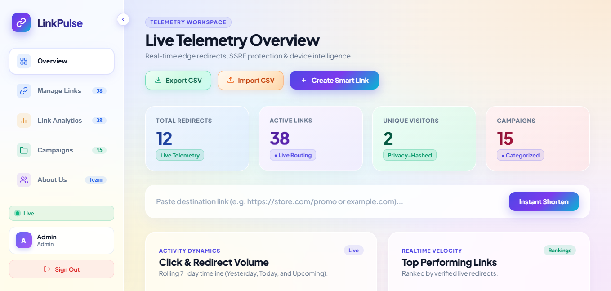
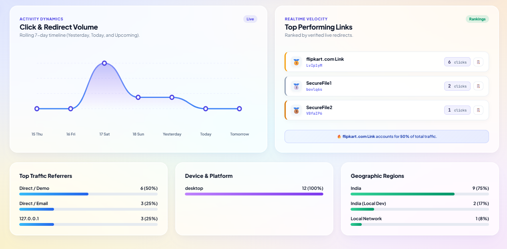
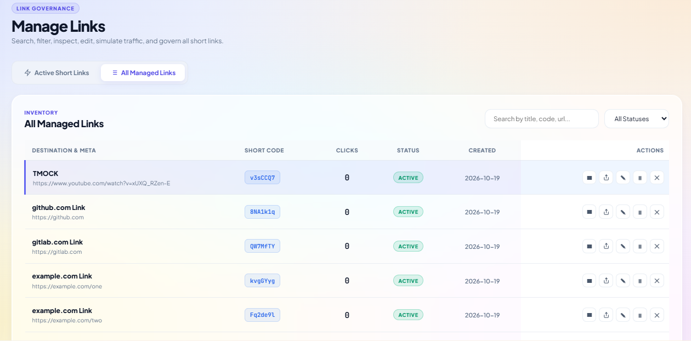
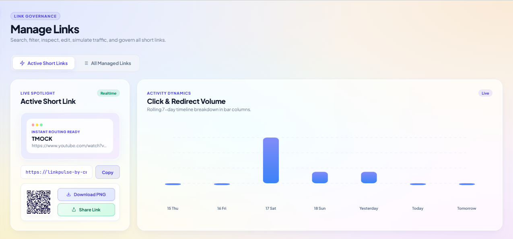
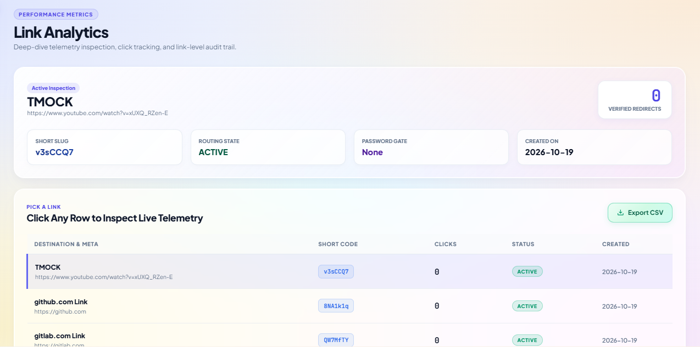
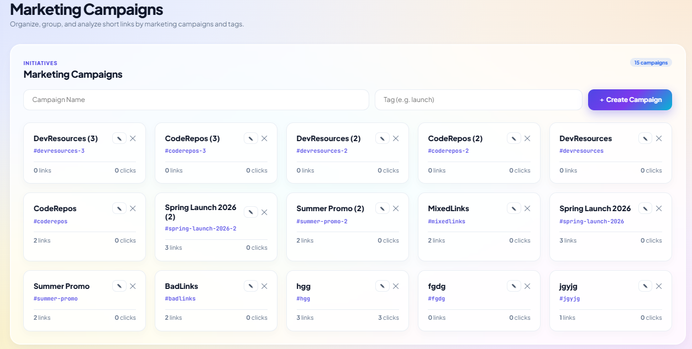
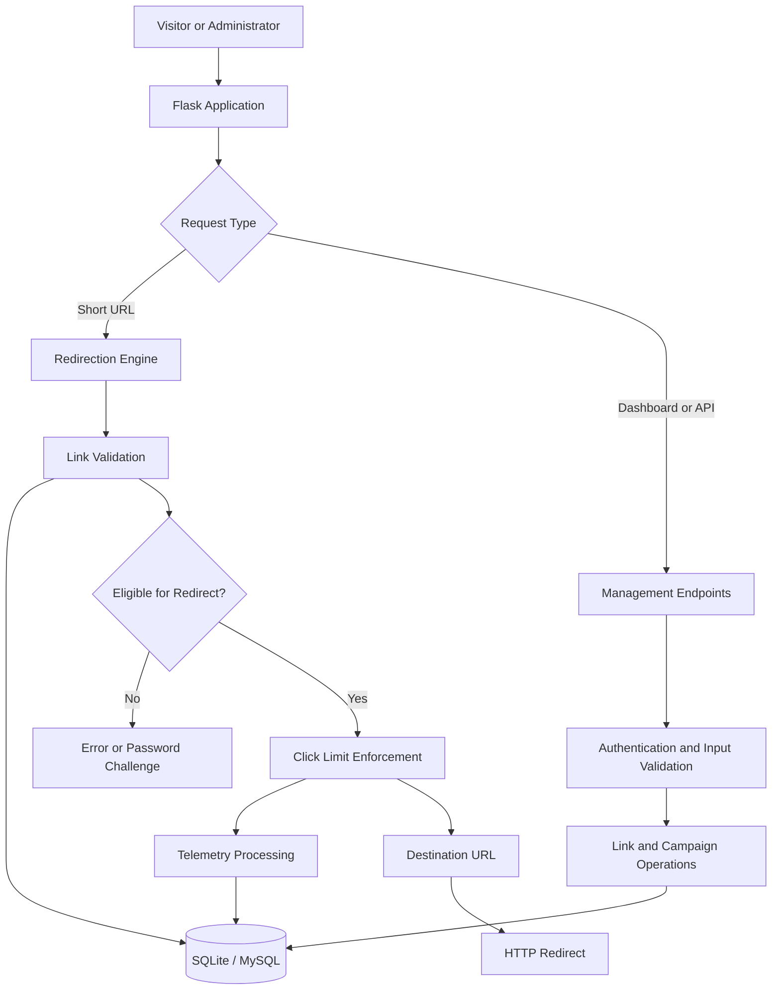

# 🔗 LinkPulse — Intelligent Link Management & Telemetry Engine

[](https://www.python.org/)
[](https://flask.palletsprojects.com/)
[](https://www.sqlite.org/)
[](LICENSE)
[](#screenshots)

**LinkPulse is a URL management and analytics platform that gives you more control over every link you share.**

Built with Python and Flask, it brings short-link creation, click tracking, campaign management, and access controls together in one dashboard. Whether you're organizing links for a project or tracking the performance of a campaign, LinkPulse helps you manage your links and understand how they're being used.

🌐 **Live Demo:** [Try LinkPulse](https://linkpulse-by-cwc.onrender.com/)

---

## 📑 Table of Contents

- [Overview](#overview)
- [Key Features](#key-features)
- [Screenshots](#screenshots)
- [System Architecture](#system-architecture)
- [Redirect Lifecycle](#redirect-lifecycle)
- [Security and Reliability](#security-and-reliability)
- [Technology Stack](#technology-stack)
- [Project Structure](#project-structure)
- [Getting Started](#getting-started)
- [Configuration](#configuration)
- [API Reference](#api-reference)
- [Deployment](#deployment)
- [Testing and Troubleshooting](#testing-and-troubleshooting)
- [Future Roadmap](#future-roadmap)
- [License](#license)

---

## Overview

Sharing a link is easy. Managing hundreds of them, keeping track of clicks, organizing campaigns, and controlling access is a different story.

LinkPulse was built to bring these tasks into one place. It lets you create and manage short links, monitor traffic, organize links into campaigns, and apply rules such as expiration dates and click limits.

The project also explores how a lightweight Flask application can combine backend logic, database operations, analytics, and a modern web interface into a single application.

### What LinkPulse aims to do

- Make long URLs easier to share.
- Keep link management organized in one dashboard.
- Track clicks and view available traffic insights.
- Set click limits and expiration rules.
- Protect selected links with password verification.
- Group links into campaigns.
- Generate QR codes for easy sharing.
- Import and export link data through CSV files.
- Provide a responsive interface with a glassmorphic design.

---

## Key Features

### ⚡ Short-Link Management

Create compact links and manage them from a central dashboard.

- **Short URLs:** Generate seven-character Base62 aliases, with collision checks.
- **Link Controls:** Create, edit, search, activate, deactivate, and delete links.
- **Click Limits:** Configure a maximum number of clicks where supported.
- **Expiration Dates:** Set links to stop working after a specified deadline.
- **Password Protection:** Add an extra access check to supported links.
- **Campaign Organization:** Keep related links grouped together.
- **Quick Redirects:** Handle short-link requests through Flask and database lookups.

### 📊 Traffic Analytics

Get a clearer picture of how your links are being used.

- **Click Trends:** View daily click activity and supported date ranges.
- **Device Categories:** Classify visitors as mobile, tablet, or desktop where detection is available.
- **Browser Information:** Identify common browser families from user-agent data.
- **Geographic Information:** Use supported country information, including Cloudflare's `CF-IPCountry` header when configured.
- **Bot Filtering:** Identify common automated clients to make traffic reports more useful.
- **Traffic Breakdowns:** Explore available aggregate analytics.
- **Privacy-Aware Identifiers:** Use salted hashes for IP-derived analytics identifiers where implemented.

### 🎯 Campaigns and Productivity

Keep link-related tasks simple and organized.

- **Campaign Tracking:** Group links and review supported campaign metrics.
- **QR Code Generation:** Generate QR codes for short URLs and save them as PNG images.
- **CSV Import:** Import up to 2,500 links per batch where supported.
- **CSV Export:** Export link data in a spreadsheet-friendly format.
- **Click Simulation:** Test link behavior and analytics without relying entirely on real visits.

### 🎨 Dashboard and User Experience

LinkPulse uses a glassmorphic interface to bring its management tools together.

- Translucent UI elements and modern visual styling.
- Responsive layouts for supported screen sizes.
- Dedicated login and dashboard pages.
- Interactive charts and link-management controls.
- Navigation for links, analytics, and campaigns.
- Plus Jakarta Sans and JetBrains Mono typography.

---

## Screenshots

Here are some views of the LinkPulse interface.

> Make sure the filenames below match the actual images inside `Outputs/`. GitHub paths are case-sensitive.

### Login Page



### Landing Page



### Dashboard Overview



### Link Management



### Active Short Link



### Analytics Dashboard



### Marketing Campaigns



---

## System Architecture

LinkPulse uses a layered structure to keep request handling, link validation, database operations, and analytics organized.



### Main Components

| File or Directory | What It Does |
|---|---|
| `app.py` | Handles Flask routes and application logic |
| `app_config.py` | Contains application configuration |
| `database.py` | Handles database connections and queries |
| `helpers.py` | Provides validation and supporting utilities |
| `frontend/index.html` | Main dashboard interface |
| `frontend/login.html` | Login page |
| `frontend/style.css` | Dashboard styling and responsive layouts |
| `requirements.txt` | Lists Python dependencies |
| `Outputs/` | Stores project screenshots and visual assets |

The architecture diagram is a high-level overview. The actual request flow depends on how the application is implemented.

---

## Redirect Lifecycle

When someone opens a LinkPulse short URL, the application generally needs to:

1. Look up the requested alias.
2. Check whether the link exists.
3. Confirm that the link is active.
4. Check its expiration settings.
5. Verify the password if the link is protected.
6. Enforce the configured click limit.
7. Record eligible analytics data.
8. Redirect the visitor to the destination.

The exact order of these operations depends on the implementation.

### Handling Click Limits

A conditional database update can help prevent concurrent requests from exceeding a configured click limit.

For example:

```sql
UPDATE links
SET click_count = click_count + 1
WHERE id = ?
  AND is_active = 1
  AND (click_limit IS NULL OR click_count < click_limit);
```

This query is an illustration, not a verified copy of the project's database implementation. Table names, column names, and transaction handling should match the actual schema.

The application should also check whether the update affected a row before allowing the redirect.

---

## Security and Reliability

Link management involves more than generating short URLs. Destinations need to be validated, administrative operations need appropriate access controls, and sensitive configuration values need to be handled carefully.

LinkPulse is designed around several defensive practices, depending on which controls are implemented and enabled.

| Area | Purpose |
|---|---|
| URL Validation | Check destination URLs before accepting them |
| SSRF Protection | Help prevent unsafe destination hosts from being accepted |
| IP Address Checks | Reject disallowed address ranges where implemented |
| Domain Rules | Block destinations matching configured restrictions |
| Credential Checks | Reject URLs containing embedded credentials |
| Click Limits | Control how many redirects a link can receive |
| Rate Limiting | Help reduce repeated or abusive requests |
| Password Protection | Verify access to protected links on the server |
| Privacy-Aware Analytics | Use salted hashes for supported IP-derived identifiers |
| Environment Configuration | Keep application secrets out of source code |

### Base62 Short Codes

LinkPulse uses seven-character Base62 aliases.

Since Base62 provides 62 possible characters per position, seven-character aliases have a theoretical combination space of:

**62⁷ = 3,521,614,606,208**

Collision checks can help prevent duplicate aliases. However, a large combination space does not automatically make generated links cryptographically secure or unpredictable.

### Before Deploying Publicly

- Use HTTPS.
- Set a strong, unique application secret.
- Protect administrative routes with authentication and authorization.
- Store passwords using a suitable password-hashing algorithm.
- Validate URL schemes and reject embedded credentials.
- Check resolved IPv4 and IPv6 addresses when enforcing destination restrictions.
- Consider DNS rebinding and redirect behavior when implementing SSRF defenses.
- Configure trusted proxy headers correctly.
- Rate-limit login and other sensitive endpoints.
- Avoid logging passwords, session tokens, or unnecessary visitor information.
- Keep dependencies updated.

**Note:** URL validation alone cannot guarantee complete SSRF protection. The actual level of protection depends on the application's DNS resolution, network access, and redirect handling.

---

## Technology Stack

| Category | Technology |
|---|---|
| Language | Python 3.10+ |
| Backend | Flask 3.x |
| Database | SQLite, with MySQL / MariaDB where configured |
| Frontend | HTML5, CSS3, Vanilla JavaScript ES6+ |
| UI | Glassmorphism and responsive CSS |
| QR Codes | QRCode.js |
| Database Utilities | Custom database adapter |
| Security Utilities | Werkzeug and custom validation helpers |
| Typography | Plus Jakarta Sans and JetBrains Mono |
| Configuration | Environment variables |
| Deployment | Python-compatible hosting or Linux VPS |

Check `requirements.txt` and the application configuration for the exact dependencies and versions used by your setup.

---

## Project Structure

The repository is organized around the Flask application, its frontend, supporting modules, and screenshots.

```text
LinkPulse-By-CWC/
│
├── Outputs/
│   ├── Group_Logo.png
│   ├── LinkPulse_ActiveShortLink.png
│   ├── LinkPulse_Analytics.png
│   ├── LinkPulse_First_Page.png
│   ├── LinkPulse_LoginPage.png
│   ├── LinkPulse_ManageLinks.png
│   ├── LinkPulse_MarketingCampaigns.png
│   └── LinkPulse_Overview.png
│
├── frontend/
│   ├── index.html
│   ├── login.html
│   └── style.css
│
├── app.py
├── app_config.py
├── database.py
├── helpers.py
├── linkpulse.db
├── requirements.txt
└── README.md
```

This is an example layout. Update it if your repository contains additional files or uses different filenames.

**Database note:** If `linkpulse.db` contains local or real visitor records, review it before committing. Never publish credentials or private production data.

---

## Getting Started

Want to run LinkPulse locally? Follow these steps.

### Prerequisites

You'll need:

- Python 3.10 or later
- pip
- Git
- Any additional database configured for your setup

### 1. Clone the Repository

```bash
git clone https://github.com/teamcwc2305-netizen/LinkPulse-By-CWC.git
cd LinkPulse-By-CWC
```

### 2. Create a Virtual Environment

**Windows — Command Prompt**

```bat
python -m venv venv
venv\Scripts\activate
```

**Windows — PowerShell**

```powershell
python -m venv venv
.\venv\Scripts\Activate.ps1
```

**macOS / Linux**

```bash
python3 -m venv venv
source venv/bin/activate
```

### 3. Install Dependencies

```bash
python -m pip install --upgrade pip
pip install -r requirements.txt
```

### 4. Configure the Application

If the application supports loading environment variables from a `.env` file, create one in the repository root.

Example:

```dotenv
SECRET_KEY=replace-with-a-strong-random-secret
PUBLIC_BASE_URL=http://127.0.0.1:5000
DB_ENGINE=sqlite
SQLITE_PATH=linkpulse.db
```

These are example settings. Check `app_config.py` and the database code to confirm the variable names your version actually supports.

Keep production secrets out of Git.

### 5. Start the Application

```bash
python app.py
```

If the application uses the default Flask development server, open:

**http://127.0.0.1:5000**

The actual address and port depend on your configuration.

---

## Configuration

LinkPulse may use environment variables to control application behavior.

| Variable | Purpose | Example |
|---|---|---|
| `SECRET_KEY` | Supports session security and signing operations | A strong, unique secret |
| `PUBLIC_BASE_URL` | Base URL used when generating short links | `https://links.example.com` |
| `DB_ENGINE` | Selects the database engine | `sqlite` |
| `SQLITE_PATH` | SQLite database location | `linkpulse.db` |

Check the source code for the exact settings supported by your version.

### Recommended Practices

- Keep local secrets in `.env`.
- Add `.env` to `.gitignore`.
- Use placeholder values in `.env.example`.
- Set the correct public domain before deployment.
- Use HTTPS for public traffic.
- Confirm that the production database has persistent storage.
- Review database initialization and migration behavior.

---

## API Reference

The following table provides an overview of the intended API endpoints. Check `app.py` before relying on these paths or methods, since the actual routes and payload formats depend on the implementation.

| Method | Endpoint | Purpose |
|---|---|---|
| `POST` | `/api/login` | Authenticate administrative credentials |
| `GET` | `/api/links` | Retrieve links and supported filters |
| `POST` | `/api/links` | Create a short link |
| `PATCH` | `/api/links/<id>` | Update link properties |
| `PATCH` | `/api/links/<id>/status` | Change link status |
| `DELETE` | `/api/links/<id>` | Delete a link |
| `POST` | `/api/links/<id>/simulate-click` | Simulate a visit for testing |
| `GET` | `/api/analytics/summary` | Retrieve aggregate analytics |
| `GET` | `/api/analytics/clicks?days=7` | Retrieve daily click trends |
| `GET` | `/api/analytics/breakdown` | Retrieve available traffic breakdowns |
| `POST` | `/api/campaigns` | Create a campaign |
| `POST` | `/api/links/import` | Import links from CSV |
| `GET` | `/api/links/export` | Export link data as CSV |

### Example: Create a Short Link

Illustrative request:

```http
POST /api/links
Content-Type: application/json
```

```json
{
  "destination_url": "https://github.com/",
  "title": "GitHub",
  "click_limit": 100
}
```

The payload is an example. Use the field names and response format supported by the actual API.

### API Considerations

- Validate incoming data on the server.
- Require authentication for protected operations.
- Return appropriate HTTP status codes.
- Validate filtering and pagination parameters.
- Apply rate limits to sensitive endpoints.
- Avoid returning internal errors or secret values to clients.
- Document the actual request and response schemas.

---

## Deployment

LinkPulse can be deployed to a Python-compatible hosting platform or a Linux server. The exact process depends on the hosting provider and the application's configuration.

### 1. Set Up a Production Server

For a compatible Linux environment, Gunicorn can serve the Flask application if it is not already included in the dependencies.

Add the following to `requirements.txt` if needed:

```text
gunicorn>=21.2.0
```

Then install the dependencies:

```bash
pip install -r requirements.txt
```

### 2. Configure the Start Command

For a hosting provider that supports a `Procfile`, an example command is:

```text
web: gunicorn app:app
```

This assumes `app.py` exposes a Flask instance named `app`. Change the command if your entry point uses a different name.

### 3. Set Production Variables

Configure the necessary environment variables through your hosting provider.

Check the following before deploying:

- Application secret
- Public base URL
- Database connection settings
- Persistent storage
- HTTPS and proxy configuration

### 4. Test the Live Deployment

After deployment, check that:

1. The application opens successfully.
2. Login and session handling work.
3. New short links can be created.
4. Redirects respect status, expiration, and click-limit settings.
5. Protected links behave as expected.
6. Analytics update correctly.
7. CSV import/export and QR generation work where implemented.
8. Application logs show no configuration or database errors.

### Choosing a Database

SQLite can be a practical choice for local development and some single-instance deployments. Applications running across multiple instances may benefit from a shared database such as MySQL or MariaDB.

Check your hosting provider's storage rules before relying on a local SQLite file; local files may not persist across restarts or redeployments.

---

## Testing and Troubleshooting

Before sharing a release, run through the main workflows and confirm that each behaves as expected.

| Test | What to Check |
|---|---|
| Create a short link | A unique alias is generated |
| Open a valid link | The destination opens correctly |
| Open an unknown alias | An appropriate not-found response appears |
| Deactivate a link | Redirects are denied |
| Reach the click limit | Further redirects follow the configured policy |
| Open an expired link | Expiration rules are enforced |
| Open a protected link | Password verification is required |
| Generate a QR code | The code points to the intended short URL |
| Import a CSV | Valid rows are processed and invalid rows are reported |
| View analytics | Available metrics display correctly |
| Submit an invalid destination | Validation rules reject it |

These are recommended checks, not a claim that automated tests already exist.

### Common Problems

**The application won't start**

- Check your Python version.
- Activate the virtual environment.
- Install the required packages.
- Review configuration values and startup logs.

**Database errors**

- Confirm the selected database engine.
- Check connection settings and file paths.
- Verify that the database schema has been initialized.

**Short links aren't redirecting**

- Confirm the alias exists and is active.
- Check expiration and click-limit settings.
- Review the destination URL and application logs.

**Analytics aren't updating**

- Check whether click events are being recorded.
- Review date filters and bot-filtering rules.
- Confirm the relevant database queries are returning data.

**Generated links use the wrong domain**

- Check `PUBLIC_BASE_URL`.
- Review HTTPS and reverse-proxy settings.
- Restart or redeploy the application if configuration changes require it.

---

## Future Roadmap

There is room to take LinkPulse further. Possible next steps include:

- Custom domains and branded short links.
- Multi-tenant accounts and role-based access control.
- Improved bot detection and abuse monitoring.
- Background processing for high-volume telemetry.
- More detailed campaign comparisons and analytics exports.
- Custom analytics date ranges.
- Automated tests and continuous integration.
- Expanded API documentation and integration examples.

These are potential future improvements, not a list of features guaranteed to be available today.

---

## License

LinkPulse is intended to be distributed under the MIT License. Make sure the repository contains the correct MIT license text in its `LICENSE` file.

See [LICENSE](LICENSE) for details.

---

<div align="center">

### 🔗 Shorten Smarter. Track Better. Govern Every Link.

**LinkPulse — Intelligent Link Management & Telemetry Engine**

Built with Python, Flask, SQL, and modern web technologies.

[**Live Demo**](https://linkpulse-by-cwc.onrender.com/) · [**GitHub Repository**](https://github.com/teamcwc2305-netizen/LinkPulse-By-CWC)

</div>
