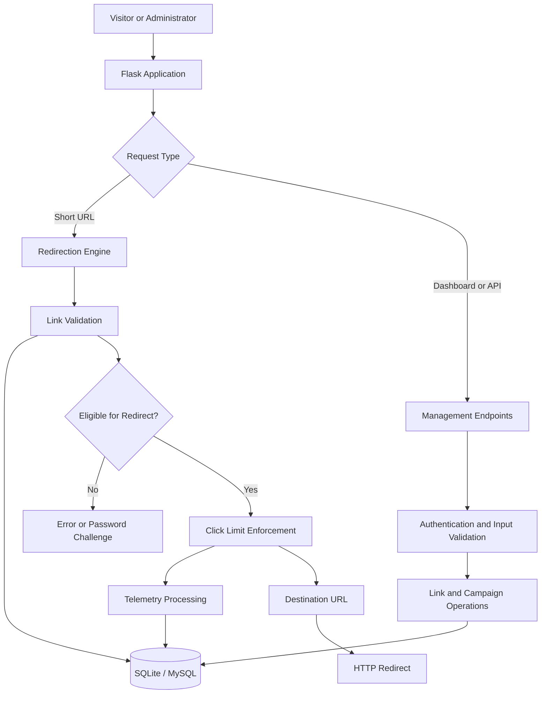

# 🔗 LinkPulse — Intelligent Link Management & Telemetry Engine

[](https://www.python.org/)
[](https://flask.palletsprojects.com/)
[](https://www.sqlite.org/)
[](LICENSE)
[](#screenshots)

**LinkPulse** is an intelligent URL management, redirection, and traffic analytics platform designed to make link sharing faster, safer, and more measurable.

Built with Python and Flask, LinkPulse combines centralized short-link management, click-limit enforcement, destination validation, password-protected links, campaign attribution, QR code generation, and traffic telemetry in a modern glassmorphic dashboard.

🌐 **Live Demo:** [LinkPulse — Try It Online](https://linkpulse-by-cwc.onrender.com/)

---

## 📑 Table of Contents

- [Overview](#-overview)
- [Key Features](#-key-features)
- [Screenshots](#-screenshots)
- [System Architecture](#-system-architecture)
- [Redirect Lifecycle](#-redirect-lifecycle)
- [Security and Reliability](#-security-and-reliability)
- [Technology Stack](#-technology-stack)
- [Project Structure](#-project-structure)
- [Getting Started](#-getting-started)
- [Configuration](#-configuration)
- [API Reference](#-api-reference)
- [Deployment](#-deployment)
- [Testing and Troubleshooting](#-testing-and-troubleshooting)
- [Future Roadmap](#-future-roadmap)
- [License](#-license)

---

## 🚀 Overview

Traditional URL shorteners focus primarily on converting long URLs into compact links. LinkPulse extends this functionality with link governance, traffic insights, campaign organization, and configurable access controls.

The platform provides a centralized workspace for creating, managing, monitoring, and analyzing short links while applying validation and request controls to help mitigate redirect abuse.

### Project Objectives

- Generate compact, shareable short URLs.
- Provide centralized link and campaign management.
- Enforce configured click limits and expiration policies.
- Support password-protected destinations.
- Visualize traffic trends and visitor categories.
- Filter common automated clients from human-oriented analytics.
- Generate downloadable QR codes.
- Support bulk CSV import and data export.
- Deliver a responsive dashboard with a modern glassmorphic interface.

---

## ✨ Key Features

### 1. ⚡ Intelligent Link Management

- **Compact Short URLs:** Generate seven-character Base62 aliases, subject to collision checks.
- **Link Lifecycle Controls:** Create, update, search, activate, deactivate, and delete links.
- **Click Limits:** Apply conditional database updates to help enforce configured maximum click counts under concurrent requests.
- **Expiration Policies:** Prevent redirects after configured expiration deadlines.
- **Password Protection:** Require server-side password verification for protected destinations.
- **Link Organization:** Group links into campaigns for easier management.
- **Fast Redirection:** Use lightweight Flask request handling and database lookups for efficient redirect processing.

### 2. 📊 Traffic Analytics and Telemetry

- **Click Trends:** Visualize daily traffic patterns, including seven-day trends where supported.
- **Device Classification:** Categorize supported visitors as mobile, tablet, or desktop.
- **Browser Detection:** Identify common browser families from user-agent information.
- **Geographic Insights:** Use the Cloudflare `CF-IPCountry` header with a configured fallback where available.
- **Bot Filtering:** Identify common crawlers and automated clients to improve human-traffic analysis.
- **Traffic Breakdown:** Review supported categorical analytics and aggregate statistics.
- **Privacy-Aware Identifiers:** Use salted SHA-256 hashes for IP-derived analytics identifiers rather than storing raw IP addresses for those identifiers.

### 3. 🎯 Campaign Management and Productivity

- **Campaign Attribution:** Organize short links into campaigns and analyze supported aggregate metrics.
- **Dynamic QR Codes:** Generate QR codes in the browser and export them as PNG images.
- **Bulk CSV Import:** Import up to 2,500 links per batch, with row-level validation feedback where implemented.
- **CSV Export:** Export link records in an Excel-compatible UTF-8 format with BOM encoding.
- **Click Simulator:** Simulate visits for testing link behavior and analytics updates.

### 4. 🎨 Modern Glassmorphic Dashboard

- Translucent surfaces and contemporary visual styling.
- Responsive layouts for supported screen sizes.
- Interactive charts and link management controls.
- Dedicated login and dashboard interfaces.
- Plus Jakarta Sans and JetBrains Mono typography.
- Organized navigation for links, analytics, and campaigns.

---

## 📸 Screenshots

Screenshots provide a visual overview of the LinkPulse interface and its core workflows.

> The image paths below assume the filenames exist in the repository's `Outputs/` directory. Verify the exact spelling and capitalization before publishing.

### Login Page


### Landing Page


### Dashboard Overview


### Link Management


### Active Short Link


### Analytics Dashboard


### Marketing Campaigns


---

## 🏗️ System Architecture

LinkPulse follows a layered architecture that separates HTTP request handling, validation, database operations, and analytics processing.



### Core Components

| Component | Responsibility |
|---|---|
| `app.py` | Flask application, routing, and API endpoints |
| `app_config.py` | Application settings and environment configuration |
| `database.py` | Database connectivity and query operations |
| `helpers.py` | Validation, security utilities, and supporting functions |
| `frontend/index.html` | Main dashboard interface |
| `frontend/login.html` | Login interface |
| `frontend/style.css` | Styling, responsive layouts, and glassmorphism |
| `requirements.txt` | Python dependency declarations |
| `Outputs/` | Project screenshots and visual assets |

The component names should match the files in the actual repository.

---

## 🔄 Redirect Lifecycle

A typical short-link request follows this workflow:

1. **Request:** A visitor opens a short URL.
2. **Lookup:** The application retrieves the corresponding link record.
3. **Existence Check:** The application verifies that the alias exists.
4. **Status Validation:** The engine checks whether the link is active.
5. **Expiration Check:** The configured expiration deadline is evaluated.
6. **Access Control:** Protected links require successful password verification.
7. **Click-Limit Enforcement:** A conditional database update checks and increments the click count.
8. **Telemetry Processing:** The visit is evaluated by the supported analytics pipeline.
9. **Redirection:** Eligible visitors are redirected to the destination URL.

The precise order of validation, database operations, and telemetry processing depends on the implementation.

### Atomic Click-Limit Enforcement

A conditional SQL update can help prevent concurrent requests from exceeding a configured click limit:

```sql
UPDATE links
SET click_count = click_count + 1
WHERE id = ?
  AND is_active = 1
  AND (click_limit IS NULL OR click_count < click_limit);
```

This is an illustrative example. Adapt the table name, column names, placeholders, and eligibility conditions to the actual database schema.

The application should check the number of affected rows and use appropriate transaction handling to determine whether the click was successfully recorded.

---

## 🛡️ Security and Reliability

LinkPulse incorporates defensive controls intended to reduce redirect abuse, protect administrative operations, and improve the reliability of link management.

| Security Layer | Purpose |
|---|---|
| Destination Validation | Validate destination URLs against configured rules |
| SSRF-Oriented Protection | Reject prohibited hosts and address ranges where implemented |
| Private IP Protection | Check for loopback, private, link-local, and other disallowed addresses |
| Domain Blocklist | Reject destinations matching configured prohibited-domain rules |
| Credential Validation | Reject URLs containing embedded credentials |
| Click-Limit Enforcement | Use conditional SQL updates to reduce concurrency-related limit violations |
| Rate Limiting | Apply request limits to help mitigate endpoint abuse |
| Password Protection | Verify protected-link passwords on the server |
| Privacy-Aware Analytics | Use salted hashes for IP-derived analytics identifiers |
| Secret Management | Support environment-based application configuration |

### Short-Code Generation

LinkPulse uses seven-character Base62 aliases.

Base62 uses 62 possible characters per position. The theoretical number of seven-character combinations is:

\[
62^7 = 3,521,614,606,208
\]

Collision checks and retry handling help prevent duplicate aliases.

This figure represents the theoretical combination space, not a guarantee of cryptographic security or unpredictable link generation.

### Production Security Checklist

Before exposing an application publicly:

- Enforce HTTPS.
- Use a strong, unique application secret.
- Protect administrative routes with authentication and authorization.
- Store passwords using an appropriate secure password-hashing algorithm.
- Validate URL schemes and reject embedded credentials.
- Resolve hostnames and validate IPv4 and IPv6 addresses where applicable.
- Account for DNS rebinding and redirects when enforcing SSRF protection.
- Configure trusted proxy headers correctly.
- Apply rate limits to login and other sensitive endpoints.
- Avoid logging passwords, session tokens, and unnecessary visitor information.
- Keep dependencies updated and review security advisories.

**Important:** URL validation alone does not guarantee complete SSRF protection. The actual protection level depends on the implementation and its handling of DNS resolution, redirects, and network requests.

---

## 🧰 Technology Stack

| Category | Technology |
|---|---|
| Programming Language | Python 3.10+ |
| Backend Framework | Flask 3.x |
| Database | SQLite, MySQL / MariaDB where configured |
| Database Access | Custom database adapter |
| Frontend | HTML5, CSS3, Vanilla JavaScript ES6+ |
| UI Design | Glassmorphism and responsive CSS |
| QR Generation | QRCode.js |
| Analytics | JavaScript charting and user-agent parsing |
| Security Utilities | Werkzeug and custom validation helpers |
| Typography | Plus Jakarta Sans, JetBrains Mono |
| Configuration | Environment variables |
| Deployment | Python-compatible hosting or Linux VPS |

The listed stack describes the intended project architecture. Confirm the exact packages and versions against `requirements.txt` before deployment.

---

## 📁 Project Structure

```text
linkpulse/
│
├── Outputs/
│   ├── Group_Logo.png
│   ├── LinkPulse_ActiveShortLink.png
│   ├── LinkPulse_Analytics.png
│   ├── LinkPulse_First_Page.png
│   ├── LinkPulse_LoginPage.png
│   ├── LinkPulse_ManageLinks.png
│   ├── LinkPulse_MarketingCampaigns.png
│   └── LinkPulse_Overview.png
│
├── frontend/
│   ├── index.html
│   ├── login.html
│   └── style.css
│
├── app.py
├── app_config.py
├── database.py
├── helpers.py
├── linkpulse.db
├── requirements.txt
└── README.md
```

This structure is illustrative. Update it if the repository contains additional files, different filenames, environment templates, or separate test directories.

**Database note:** If `linkpulse.db` is a locally generated database, decide whether it should be committed. Avoid publishing real credentials, private visitor data, or production records.

---

## ⚙️ Getting Started

### Prerequisites

Install the following tools:

- Python 3.10 or higher
- pip
- Git
- A supported database, depending on the selected configuration

### 1. Clone the Repository

```bash
git clone https://github.com/teamcwc2305-netizen/LinkPulse-By-CWC.git
cd LinkPulse-By-CWC
```

If your local repository directory has a different name, change the `cd` command accordingly.

### 2. Create a Virtual Environment

**Windows — Command Prompt**

```bat
python -m venv venv
venv\Scripts\activate
```

**Windows — PowerShell**

```powershell
python -m venv venv
.\venv\Scripts\Activate.ps1
```

**macOS / Linux**

```bash
python3 -m venv venv
source venv/bin/activate
```

### 3. Install Dependencies

```bash
python -m pip install --upgrade pip
pip install -r requirements.txt
```

### 4. Configure Environment Variables

Create a local `.env` file if the application supports loading environment variables from it.

For example:

```dotenv
SECRET_KEY=replace-with-a-strong-random-secret
PUBLIC_BASE_URL=http://127.0.0.1:5000
DB_ENGINE=sqlite
SQLITE_PATH=linkpulse.db
```

These are example values, not a guarantee that every variable is required or recognized by the application. Verify supported settings in `app_config.py` and the database implementation.

Do not commit production secrets or real credentials.

### 5. Run the Application

```bash
python app.py
```

Open the application in your browser:

**http://127.0.0.1:5000**

The actual host and port depend on the application's runtime configuration.

---

## 🔧 Configuration

The following variables illustrate common configuration options for LinkPulse.

| Variable | Purpose | Example |
|---|---|---|
| `SECRET_KEY` | Secret used for session security and supported signing operations | A strong, unique secret |
| `PUBLIC_BASE_URL` | Public base URL used to generate short links | `https://links.example.com` |
| `DB_ENGINE` | Selects the configured database engine | `sqlite` |
| `SQLITE_PATH` | Database file path when SQLite is selected | `linkpulse.db` |

Configuration requirements depend on the actual implementation.

### Recommended Practices

- Keep local secrets in `.env`.
- Add `.env` to `.gitignore`.
- Commit `.env.example` only if it contains placeholder values.
- Use HTTPS for public deployments.
- Configure the public base URL to match the deployed domain.
- Use persistent database storage.
- Store production secrets in the hosting platform's secret-management system where available.
- Verify database initialization and migration behavior before deployment.

---

## 🔌 API Reference

The following endpoints summarize the intended API surface described for LinkPulse. Verify their registration, HTTP methods, payloads, authentication requirements, and response schemas against `app.py` before treating this table as a guaranteed API contract.

| Method | Endpoint | Description |
|---|---|---|
| `POST` | `/api/login` | Authenticate administrative credentials |
| `GET` | `/api/links` | Retrieve links and supported filters |
| `POST` | `/api/links` | Create a short link |
| `PATCH` | `/api/links/<id>` | Update supported link properties |
| `PATCH` | `/api/links/<id>/status` | Change link status |
| `DELETE` | `/api/links/<id>` | Delete a link record |
| `POST` | `/api/links/<id>/simulate-click` | Simulate a visit for testing |
| `GET` | `/api/analytics/summary` | Retrieve aggregate analytics |
| `GET` | `/api/analytics/clicks?days=7` | Retrieve daily click trends |
| `GET` | `/api/analytics/breakdown` | Retrieve supported traffic breakdowns |
| `POST` | `/api/campaigns` | Create a campaign |
| `POST` | `/api/links/import` | Import links from CSV |
| `GET` | `/api/links/export` | Export link records as CSV |

### Example: Create a Short Link

Illustrative request:

```http
POST /api/links
Content-Type: application/json
```

```json
{
  "destination_url": "https://github.com/",
  "title": "GitHub",
  "click_limit": 100
}
```

The field names are illustrative. Adjust them to match the actual API schema.

A successful response should return the generated short-link information according to the application's implemented response format.

### API Best Practices

- Validate all input on the server.
- Enforce authentication and authorization where required.
- Return appropriate HTTP status codes.
- Validate filtering and pagination parameters.
- Apply rate limits to sensitive endpoints.
- Avoid exposing internal exceptions or secrets.
- Document actual request and response schemas before publishing a stable API contract.

---

## 🚀 Deployment

LinkPulse can be deployed to a Python-compatible hosting platform or a Linux VPS.

### 1. Configure a Production WSGI Server

For a supported Linux deployment, add Gunicorn if it is not already included in `requirements.txt`:

```text
gunicorn>=21.2.0
```

Install the project dependencies:

```bash
pip install -r requirements.txt
```

### 2. Configure the Start Command

For a hosting platform that supports a `Procfile`, create one in the repository root:

```text
web: gunicorn app:app
```

This assumes `app.py` exports a Flask application instance named `app`. Adjust the command if the actual application entry point differs.

### 3. Configure Production Variables

Set the required environment variables in the hosting platform's configuration settings.

At minimum, verify:

- A strong production `SECRET_KEY`.
- The correct `PUBLIC_BASE_URL`.
- The configured database engine and connection details.
- Persistent storage for SQLite, if applicable.
- HTTPS and correctly configured proxy headers.

### 4. Verify the Deployment

After deployment:

1. Open the public application URL.
2. Verify login and session handling.
3. Create and test a short link.
4. Confirm active, inactive, expired, and click-limited behavior.
5. Test password-protected links where supported.
6. Verify analytics updates.
7. Test CSV import/export and QR generation where implemented.
8. Check logs for database, configuration, or routing errors.

### Database Recommendation

SQLite is suitable for development and certain single-instance deployments. Multi-instance applications generally benefit from a shared database such as MySQL or MariaDB with appropriate transaction handling and connection management.

A deployment platform does not automatically make a local SQLite file persistent. Verify the storage behavior of the selected hosting environment.

---

## 🧪 Testing and Troubleshooting

Before presenting the project, test the main workflows.

| Test | Expected Behavior |
|---|---|
| Create a short link | A unique alias is generated |
| Open a valid short link | The visitor is redirected to the configured destination |
| Open an unknown alias | An appropriate not-found response is returned |
| Deactivate a link | Further redirects are denied |
| Exceed a click limit | Additional redirects are denied according to the configured policy |
| Open an expired link | The expired-link policy is enforced |
| Access a protected link | Password verification is required |
| Generate a QR code | The QR code represents the intended short URL |
| Import a CSV file | Valid rows are processed and invalid rows are reported |
| View analytics | Supported traffic metrics are displayed |
| Submit an invalid destination | The server rejects it according to the validation rules |

These are recommended test cases, not a claim that automated tests currently exist.

### Common Issues

**Application fails to start**

- Confirm the Python version.
- Activate the correct virtual environment.
- Install dependencies from `requirements.txt`.
- Check configuration values and startup logs.

**Database connection errors**

- Verify the database engine and connection configuration.
- Check database permissions and file paths.
- Confirm database initialization and schema compatibility.

**Short links fail to redirect**

- Confirm that the alias exists and is active.
- Check expiration and click-limit policies.
- Verify the destination URL and application logs.

**Analytics are missing or inaccurate**

- Confirm that click events are recorded correctly.
- Check date filters, bot-filtering rules, and database queries.
- Verify proxy headers if location or client metadata depends on them.

**Production links use the wrong domain**

- Verify `PUBLIC_BASE_URL`.
- Check HTTPS and reverse-proxy configuration.
- Restart or redeploy after changing environment variables when required.

---

## 🛣️ Future Roadmap

Potential future enhancements include:

- Custom domains and branded short links.
- Multi-tenant accounts and role-based access control.
- Advanced bot detection and abuse monitoring.
- Asynchronous processing for high-volume telemetry.
- Expanded campaign comparisons and analytics exports.
- Configurable analytics date ranges.
- Automated testing and continuous integration.
- Enhanced API documentation and integration examples.

These are planned or potential improvements and should not be interpreted as currently implemented features.

---

## 📄 License

This project is distributed under the MIT License, provided that the repository's `LICENSE` file contains the applicable MIT license text.

See [LICENSE](LICENSE) for details.

---

<div align="center">

### 🔗 Shorten Smarter. Track Better. Govern Every Link.

**LinkPulse — Intelligent Link Management & Telemetry Engine**

Built with Python, Flask, SQL, and modern web technologies.

[**Live Demo**](https://linkpulse-by-cwc.onrender.com/) · [**GitHub Repository**](https://github.com/teamcwc2305-netizen/LinkPulse-By-CWC)

</div>
